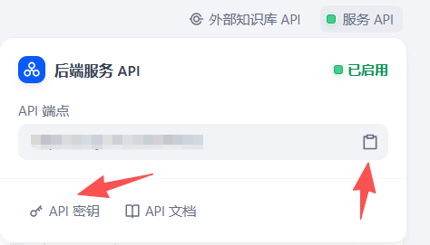
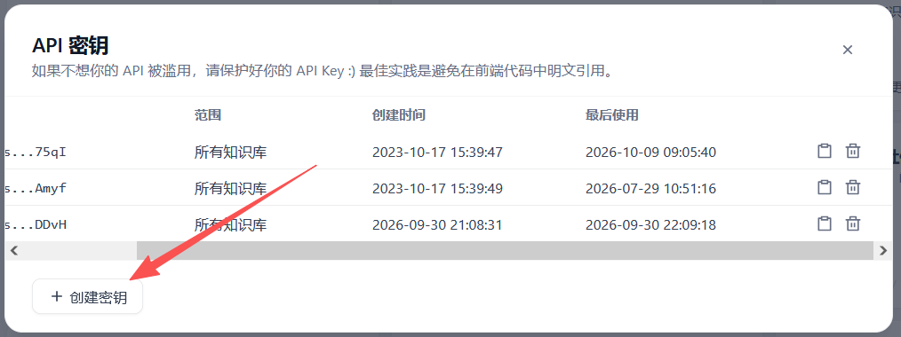
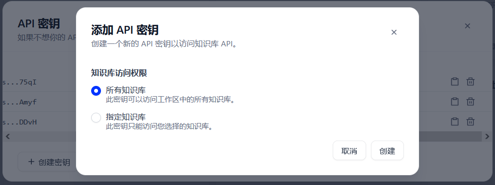
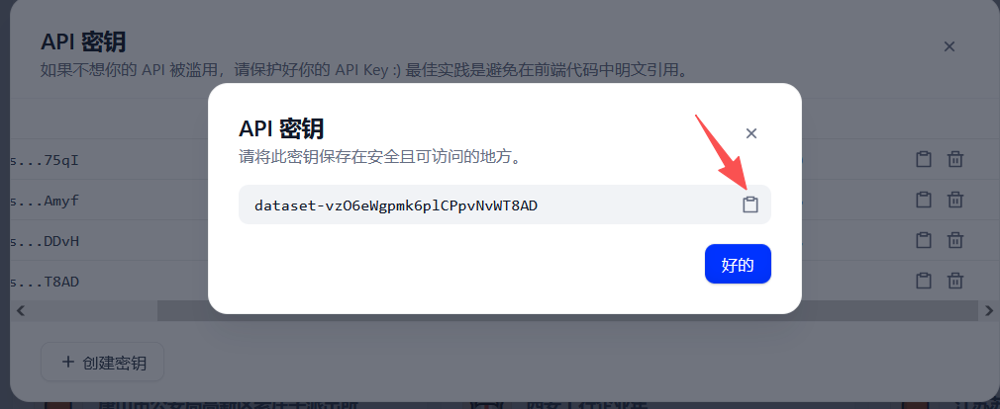
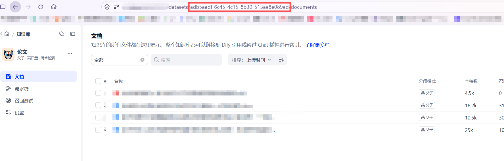

# Dify Knowledge Plugin

Tool plugin for the Dify Knowledge API. Inspect and search knowledge bases, read document segments, write text documents, track indexing, and query metadata, tags and available models.

version: 0.1.0
author: [leslie2046](https://github.com/leslie2046)
repo: [leslie2046/dify-knowledge-plugin](https://github.com/leslie2046/dify-knowledge-plugin)

## Features

- `list_datasets`: list knowledge bases with optional keyword, pagination, permission, and tag filters.
- `list_documents`: list documents in a knowledge base with optional keyword, status, and pagination filters.
- `list_segments`: read a document's segments with pagination, keyword, and indexing-status filters.
- `get_segment`: read a single segment's full details by id.
- `retrieve_chunks`: retrieve normalized chunk results from a knowledge base.
- `list_available_models`: query available Dify models by type, especially `text-embedding` and `rerank` for knowledge-base setup.
- `get_dataset`: inspect a knowledge base's configuration and statistics.
- `list_metadata_fields`: inspect metadata field names, types, usage counts and built-in-field enablement.
- `list_tags`: list workspace knowledge tags and their ids.
- `create_document_by_text`: create a text document and return its indexing batch.
- `update_document_by_text`: update an existing document's text, name or processing settings.
- `get_indexing_status`: query the processing status of a document batch.
- `retrieve_multiple`: search up to 20 knowledge bases and return deduplicated results with sources and per-dataset errors.

## Credentials

- `Base URL`: Dify Knowledge API base URL. Both `https://your-dify-host/v1` and `https://your-dify-host` are accepted. The plugin normalizes the latter to `/v1`.
- `API Key`: Dify Service API key with access to the target workspace knowledge resources.
- `Validation Dataset ID`: optional. For a key scoped to specific knowledge bases, enter an authorized knowledge base id. Credential validation then uses the detail endpoint instead of listing knowledge bases. Workspace-level tools (`list_datasets`, `list_tags`, `list_available_models`) require a key with access to all knowledge bases.

### Getting Credentials

Open the Service API panel in Dify, then copy the API endpoint into the plugin `Base URL` field.



Click `API Key` in the Service API panel, then click `Create Key`.



Choose `All Knowledge Bases` to use all tools, or `Specified Knowledge Bases` to restrict access. For a scoped key, also fill in the plugin's `Validation Dataset ID` with an authorized knowledge base id. Then click `Create`.



Copy the newly created key into the plugin `API Key` field.



## Tool Reference

### `list_datasets`

Used to inspect available knowledge bases before retrieval or document lookup.

- `keyword`: optional name filter.
- `page`: optional page number, defaults to `1`.
- `limit`: optional page size, defaults to `20`.
- `include_all`: optional flag to include all visible knowledge bases regardless of permission scope.
- `tag_ids`: optional comma-separated list or JSON array string of tag ids.

### Getting `dataset_id`

Open a knowledge base in Dify and copy the UUID between `/datasets/` and `/documents` from the browser address bar.



### `list_documents`

Used to inspect documents inside a specific knowledge base.

- `dataset_id`: required knowledge base id.
- `keyword`: optional document-name filter.
- `status`: optional status filter.
- `page`: optional page number, defaults to `1`.
- `limit`: optional page size, defaults to `20`.

### `list_segments`

Reads stored segments directly rather than searching for relevant chunks.

- `dataset_id` and `document_id`: required. Obtain document ids from `list_documents` or `retrieve_chunks`.
- `keyword`: optional segment-content filter.
- `status`: optional indexing statuses, as CSV or a JSON array string, e.g. `completed,indexing,error`. These are segment indexing statuses, not document display statuses such as `available`.
- `page` and `limit`: optional, default to `1` and `20`. The maximum page size is `100`.
- Output: `doc_form`, pagination (`page`, `limit`, `total`, `has_more`), `count`, and a `result` array. Each segment retains its content, Q&A answer, position, indexing status, enabled flag, and any returned attachments or child chunks, plus `dataset_id`, `document_id`, and `segment_id`.

To summarize a document, leave keyword/status filters empty, read subsequent pages while `has_more` is true, and use segment `position` to arrange the content. A single page is not necessarily the whole document. In Q&A mode, `content` and `answer` are preserved separately.

### `get_segment`

- `dataset_id`, `document_id`, and `segment_id`: required. Use ids from `list_segments` or `retrieve_chunks`.
- Output: `dataset_id`, `document_id`, `doc_form`, and a `result` object containing the segment details.

Use this tool to inspect a known segment, check its indexing status, or read its content without running another similarity search. It returns one segment; use `list_segments` to browse other segments in the document.

### `retrieve_chunks`

Used to retrieve relevant chunks from a specific knowledge base.

Optional retrieval parameters only affect the current request and are not saved to the knowledge base. If an optional retrieval parameter is left empty, Dify uses the retrieval configuration already saved in that knowledge base.

- `dataset_id`: required knowledge base id.
- `query`: required search query.
- `search_method`: optional retrieval-method override for internal knowledge bases.
- `top_k`: optional result-count override.
- `score_threshold_enabled` and `score_threshold`: optional similarity-threshold overrides.
- `reranking_enable` and `reranking_mode`: optional reranking overrides for internal knowledge bases.
- `reranking_provider_name` and `reranking_model_name`: required when `reranking_mode` is `reranking_model`. Available values can be obtained from `list_available_models` with `model_type=rerank`.
- `weight_type`, `vector_weight`, and `keyword_weight`: optional hybrid-search weight overrides.
- `attachment_ids`: optional comma-separated list or JSON array string of attachment ids.
- `metadata_filtering_conditions`: optional JSON object for server-side document-metadata filtering on internal knowledge bases. Query field names with `list_metadata_fields`.

When overrides or metadata filters are provided, the plugin reads the knowledge base's configuration and merges changes into it. Setting only `top_k` preserves the saved search method, reranker and weights. Explicitly disabling the score threshold takes precedence over a supplied threshold value. External knowledge bases support only `top_k` and threshold overrides; internal-only overrides and metadata filters produce an error.

Example metadata filter:

```json
{"logical_operator":"and","conditions":[{"name":"department","comparison_operator":"is","value":"support"}]}
```

Supported comparisons include string operators (`is`, `contains`, `empty`), string-array membership (`in`, `not in`), numeric comparisons and time comparisons (`before`, `after`, with numeric timestamp values). `!=`, `>=`, and `<=` are normalized to the API's Unicode operators.

### `get_dataset`, `list_metadata_fields`, and `list_tags`

- `get_dataset`: requires `dataset_id`, returns configuration and statistics in `result`, including the API's `retrieval_model_dict`.
- `list_metadata_fields`: requires `dataset_id`, returns `count`, field records in `result`, and `built_in_field_enabled`.
- `list_tags`: has no parameters, returns `count` and tag records in `result`. Use returned ids with `list_datasets.tag_ids`.

### `create_document_by_text` and `update_document_by_text`

These tools write to the knowledge base. Create requires `dataset_id`, `name`, and `text`; update additionally requires an existing `document_id` and at least one changed field. When updating text, supply `name` as well.

- Optional shared settings: `doc_form`, `doc_language`, `process_rule` (JSON object), and `retrieval_model` (complete JSON object).
- Create also supports `indexing_technique`, `embedding_model` and `embedding_model_provider`. The first document needs `indexing_technique` if it is not already configured on the knowledge base.
- Create defaults to automatic processing; update leaves processing settings unchanged when omitted. Parent-child mode requires a hierarchical `process_rule` with a `rules` object.
- Both return `dataset_id`, `document_id`, `batch` and the document record in `result`. No automatic retry or deduplication is performed for writes; repeating a create call can create another document.

### `get_indexing_status`

Requires `dataset_id` and the `batch` from a create/update response. Returns processing records in `result`, `count`, `completed` (all documents succeeded), `finished` (all reached completed/error), and `has_errors`. This is a single status request: workflows can poll it with an interval and timeout. Paused batches are not treated as completed.

### `retrieve_multiple`

- `dataset_ids`: required CSV or JSON array string; accepts 1–20 distinct ids.
- `query` and optional retrieval settings: same as `retrieve_chunks`; each knowledge base retains its own saved settings unless overridden. Metadata fields used in filters must exist in each target knowledge base.
- `max_results`: deduplicated result limit, default `20`, range `1–200`. `top_k` remains a per-knowledge-base setting.
- Output: `result`, `count`, `total_count` (unique retrieved results before the output limit), `has_more` (output was truncated), `partial_failure`, `errors`, and `ordering`.

Retrieval uses up to four concurrent requests. Results interleave the rank within each knowledge base in input order; scores are not compared across knowledge bases, and no global reranking is performed. Identical content/answer pairs are deduplicated while retaining all origins and scores in `sources`. Partial failures retain successful results; if every knowledge base fails, the tool raises an error. `has_more` does not indicate API pagination or guarantee further available hits.

### `list_available_models`

Wraps Dify's "Get Available Models" endpoint: `GET /workspaces/current/models/model-types/{model_type}`.

- `model_type`: required model type. Supported values are `text-embedding`, `rerank`, `llm`, `tts`, `speech2text`, and `moderation`.
- Output: normalized provider groups with `provider_count`, total `model_count`, and each provider's `models` list.

## Notes

- The model-list tool is mainly useful when you need to know which `text-embedding` or `rerank` values can be used in knowledge-base configuration.
- The retrieval tool only sends retrieval-model overrides when you explicitly provide them. These overrides are request-scoped and do not change the saved knowledge-base configuration.
- CSV strings like `a,b,c` and JSON array strings like `["a","b","c"]` are both accepted for list-style parameters such as `tag_ids` and `attachment_ids`.

## Support

If this plugin is helpful, a GitHub Star is appreciated. For bugs, questions, or feature requests, please open an Issue with your Dify version, plugin version, and the steps to reproduce the problem.
